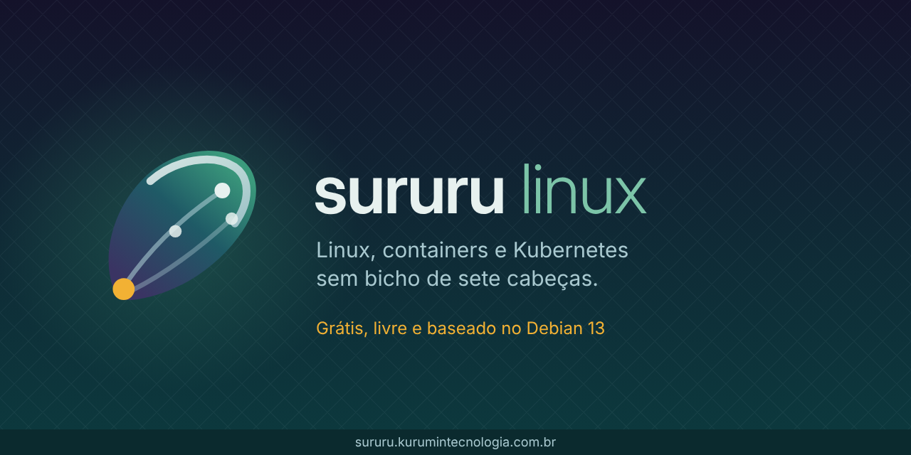

  

## Kurumin Tecnologia

Software livre brasileiro para aprender **Linux, containers e Kubernetes** em português. Feito em Alagoas.

### 🐚 Sururu Linux

Distribuição baseada no Debian 13 que boota do pendrive com um **cluster Kubernetes em um clique** e **laboratórios que se corrigem sozinhos**. Pensada para escolas técnicas, institutos federais e para quem está começando.

- **Baixar a ISO:** [sururu.kurumintecnologia.com.br](https://sururu.kurumintecnologia.com.br)
- **Documentação:** [sururu.kurumintecnologia.com.br/docs](https://sururu.kurumintecnologia.com.br/docs/)
- **Código e pipeline:** [kurumintecnologia/sururu-linux](https://github.com/kurumintecnologia/sururu-linux)

Cada versão é construída do zero no GitHub Actions, testada no QEMU, varrida com o Trivy, publicada com SBOM e assinada com cosign (Sigstore).

### Como ajudar

- Teste numa máquina diferente e [conte como foi](https://github.com/kurumintecnologia/sururu-linux/issues)
- Escreva um laboratório novo: [veja como](https://sururu.kurumintecnologia.com.br/docs/novo-laboratorio/)
- Leve para a sua turma ou [apoie o projeto](https://sururu.kurumintecnologia.com.br/docs/apoiar/)

---

Consultoria em infraestrutura Linux, automação e Kubernetes: [kurumintecnologia.com.br](https://kurumintecnologia.com.br) · contato@kurumintecnologia.com.br
